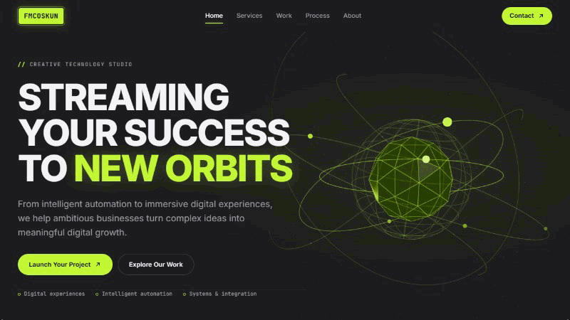

# FMCOSKUN Studio

**Streaming Your Success To New Orbits** — a single-page site for a creative technology studio, built with React 19, TypeScript and React Three Fiber. Every 3D visual is generated from code, with no model files.



## Highlights

- **Hero orbit scene**: a faceted core, four tilted rings, instanced orbiting nodes, signal streams and a starfield. A soft pointer parallax follows the mouse, and the camera dollies gently as you scroll.
- **One 3D scene per project**: each Work card illustrates the problem its project solves.
  - **P/01 Studio Website**: the orbital system in miniature, inside viewport frame marks. On hover it turns toward the viewer.
  - **P/02 Production Signal Board**: data packets flow over an isometric floor into a control matrix. An anomaly flashes red, gets caught, and the flow turns green again.
  - **P/03 Inbox-to-Workflow**: scattered envelopes pass through a prism and come out as aligned task cards in three columns.
  - **P/04 Motion Identity Kit**: one form morphs from cube to pyramid to sphere as it moves into 16:9, 9:16 and 1:1 frames.
- **3D contact scene** on the same light-grey grid stage as the project cards.
- **Honest content**: concept studies are labelled as concepts. If no endpoint is configured, the contact form says the message was not sent. It never shows a fake success.

## Performance and resilience

| Concern | Approach |
|---|---|
| First load | three / R3F / drei sit in async chunks. The 3D scene mounts after the hero text renders, so LCP never waits on it. `npm run check:bundle` fails if three.js reaches the entry chunk. |
| Scene count | The four project scenes and the contact scene share **one** transparent canvas through drei `View`. With the hero canvas, the page uses two WebGL contexts. |
| Render loop | Off-screen canvases stop rendering (`frameloop="never"`). With reduced motion, each scene shows one still frame. Shaders are precompiled while the browser is idle. |
| GPU budget | DPR is capped per tier. There are no shadow maps or post-processing. `PerformanceMonitor` steps the quality tier down when FPS stays low. |
| Fallbacks | Every scene has an SVG equivalent. It is shown while loading, without WebGL (the 3D chunk is then never downloaded), and after a lost WebGL context. |

## Accessibility

Skip link, a single `h1`, visible focus, and a mobile menu with Esc and focus return. Project details use a native `<dialog>`. Every form field has a label and inline errors. `prefers-reduced-motion` turns animation off, and nothing depends on hover on touch devices.

## Getting started

Requires **Node ≥ 20.19**. Running the unit tests requires **Node ≥ 22.18** for native TypeScript type stripping.

```bash
npm install
cp .env.example .env.local   # optional, see below
npm run dev                  # http://localhost:5173
```

| Script | Purpose |
|---|---|
| `npm run dev` | Dev server with HMR |
| `npm run typecheck` | Strict `tsc` for the app and `vite.config.ts` |
| `npm run test` | Unit tests for the scene timing math (`node --test`, no extra dependencies) |
| `npm run build` | Typecheck, then production build into `dist/` |
| `npm run check:bundle` | After a build: three.js stays out of the entry chunk and is bundled once |
| `npm run preview` | Serve `dist/` locally (run Lighthouse here) |

## Environment variables

Copy `.env.example` to `.env.local`. Every `VITE_*` value is embedded in the public bundle, so **never put secrets here.**

| Variable | Effect |
|---|---|
| `VITE_CONTACT_ENDPOINT` | HTTPS endpoint that receives `POST application/json` `{ name, email, projectType, message }`. A `2xx` response means accepted. If unset, the form shows a "not connected" state. |
| `VITE_CONTACT_EMAIL` | `mailto:` fallback shown when no endpoint is configured. |
| `VITE_SITE_URL` | Production origin used for canonical and Open Graph URLs. |

The endpoint must validate again on the server (the same Zod schema is in `src/features/contact/contactSchema.ts`). It should also rate-limit and restrict CORS to the site origin.

## Project structure

```
src/
├── app/            App shell, SEO injection
├── components/     layout (Header, Logo, Footer) · ui · motion (Reveal)
├── features/       hero · services · projects · process · about · contact
│   └── showcase/   DOM slots, SVG fallbacks and lazy loader for the shared 3D canvas
├── three/          3D layer (loaded only through the two lazy entry points)
│   ├── config/     sceneConfig.ts (hero) · showcaseConfig.ts (project + contact scenes)
│   ├── objects/ · scenes/ · hooks/   hero scene
│   └── showcase/   shared canvas, timing math, one component per scene
├── data/           site content: services, projects, process, navigation
├── hooks/          media queries, in-view, idle mount, active section
└── styles/         tokens.css (single source for colours) · global.css
tests/              node:test unit tests
scripts/            check-bundle.mjs
```

All content lives in `src/data/*.ts`. To show a real project, set `status: 'live'` and optionally add a `url` and an `image` under `/public`; an image takes the place of the 3D scene.

## Tech stack

React 19 · TypeScript (strict) · Vite 7 · three.js 0.180 · @react-three/fiber 9 · @react-three/drei 10 · Zod · CSS Modules
